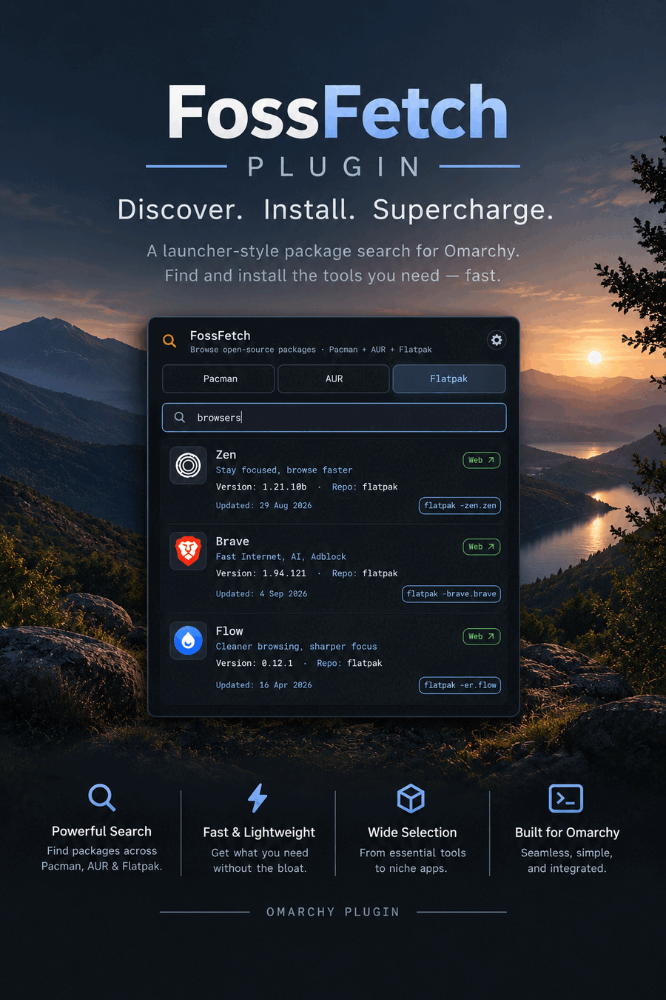

[](https://ko-fi.com/davedes)


Like the plugin? ♥️ it on the Omarchy Marketplace to help others find it.
# FossFetch

A launcher-style package search for [Omarchy](https://omarchy.org/) that hunts on
**three package ecosystems at once** — Arch repos, Flathub and the AUR — and
installs results with a quick arm-and-confirm, straight from your top bar.

Search anything FOSS: type a package name, or browse **by what it does**
("video editing", "browser", "chat"). Every result card shows real, live-scraped
metadata: version, repository, architecture, license, homepage and last-updated
date — with install buttons for each package source.

```
FossFetch — Browse open-source packages · Pacman + AUR + Flathub
```

---

## Features

### Search three ecosystems in one panel

| Tab | Source | Live query |
|-----|--------|------------|
| **Pacman** | Arch repos (core / extra / multilib) | `pacman -Ss` |
| **Flatpak** | Flathub | `flatpak search` + Flathub AppStream catalog |
| **AUR** | Arch User Repository | AUR RPC `name-desc` search |

An opt-in **All** tab merges all three into one list. It is **off by default**:
merging three backends is slower per keystroke than searching one, which is the
wrong trade for a launcher you open dozens of times a day. Turn it on with
**All results** in the options panel.

Both the Pacman and Flatpak tabs support **natural-language category browsing**
— enter a phrase like `video editing`, `browser`, `music`, `terminal` or
`discord` and matching AppStream-category members surface first, then ranked
name matches. The keyword → category mapping lives in [`groups.keywords`](groups.keywords)
and is shared by the Arch and Flathub group matchers.

### Real metadata on every card
Results are enriched on the fly:
- **Version · Repo · Arch** from `pacman -Si` (batched into one subprocess).
- **License** from `pacman -Si` / `flatpak info --show-metadata`.
- **Homepage / GitHub link** (opens externally).
- **Last updated** — pacman `Build Date`, AUR `LastModified`, or Flathub
  release timestamps — shown in the bottom-left of each card.
- **App icons**: Arch's published AppStream icon catalog, Flathub icons, plus a
  local fallback that extracts an icon from installed packages via `pacman -Ql`.

### Arm-and-confirm install, per source
Each card shows an install button for every source it can be installed from. A
Pacman result usually carries **two**: the distro package *and* its Flathub
equivalent, resolved from the local Flathub index — so you can pick the sandbox
or the repo without searching again. First click **arms** ("Confirm?"); a second
click runs the real command in your terminal:

| Button | Command |
|--------|---------|
| Pacman | `sudo pacman -S --needed <pkg>` |
| yay / paru | `yay -S --needed <pkg>` / `paru -S --needed <pkg>` |
| Flatpak | `flatpak install --assumeyes flathub <appid>` |

The terminal is read from `$TERMINAL` / `$TERMINAL_CMD` and falls back to
`kitty`. Pacman and Flatpak install attempts run independently, so arming one
never conflicts with another.

**Already installed is visible.** One batched `pacman -Qq` + `flatpak list`
snapshot marks every card that is on the machine: the button becomes an inert
"✓ Installed" pill and the card carries an `✓ Installed` chip, so a re-install is
never a surprise. The snapshot is refreshed at most once a minute and again
after an install is launched.

### Six toolbar icon designs
The "Find App" pill in the bar restyles itself live. Choose from the options
panel: **Current, Outline, Soft, Bold, Minimal, Icon** (a bare magnifying-glass
glyph). The setting is pushed to the bar widget in real time and persists.

### Install and remove
An installed package keeps its `✓ Installed` chip and the button beside it
becomes a working **Remove**. Removal is deliberately non-cascading: only the
package you named is removed, never its dependencies, because those are
usually still needed by something else. Both actions open a confirmation dialog
naming the exact package.

### Details sheet
Each card has a **Details** button showing the dependency graph, installed and
download size, provides/conflicts, and a plain-language explanation of *why*
that result matched your query. For an installed package it also lists what
requires it — the thing that tells you whether removing it would break
something else.

### Options panel (gear icon)
- Toggle the **AUR** and **Flatpak** tabs on/off.
- Toggle the merged **All** tab on/off (**off by default**).
- Clear the recent-search history.
- Choose the AUR install helper: **yay** or **paru**. The helper is
  **auto-detected** on open — if the saved one is not installed but `paru`,
  `yay` or `pikaur` is, the panel follows the machine. If the chosen helper is
  missing entirely the AUR buttons read "…missing" instead of failing silently
  in a terminal.
- Toolbar **icon design** picker.
- Compact **"Buy Me a Coffee"** button with a small tick-box to hide it.

All options persist to
`~/.local/state/omarchy/settings/davedes.fossfetch.json`.

### Built for the Omarchy shell
- **Recent searches**: the last 8 queries are kept in the options file and
  offered as chips whenever the box is empty. Cleared from the same row.
- **Match highlighting**: the matched run in a card title is accented.
- **Keyboard-first**: `Tab` / `Shift+Tab` cycles tabs, `↑`/`↓` move the
  selection, `Enter` arms the highlighted card's install (a second press runs
  it), `Esc` closes, `/` refocuses the search box. `←`/`→` are left alone so
  they edit the query like a normal text field.
- **Theme-aware**: per-ecosystem accents (green = Pacman, cyan = AUR,
  blue = Flatpak, yellow = confirm state) are read from the active theme's
  `colors.toml`, so the panel blends with whatever theme is running.
- Renders on Omarchy's frosted popup surface with the standard menu
  selected-row treatment.

---

## Requirements

- **Omarchy 4.x** (Quickshell-based shell) on **Arch Linux**
- `pacman` (base), `python3` (datastore scripts)
- Optional / feature-gated:
  - `flatpak` — for the Flatpak tab and Flatpak installs
  - `yay` or `paru` — for AUR installs
  - _optional_ `archlinux-appstream-data` — if installed, FossFetch reads the
    Arch AppStream catalog from the pacman-verified `/usr/share/swcatalog`
    files (no downloads, auto-refreshes with your system updates);
  - otherwise a network connection for the first category/icon catalog download
    (cached locally; see [Caches](#caches-and-privacy))

---

## Installation

### 1. Clone the plugin

```bash
omarchy plugin clone davedes.fossfetch
```

…or manually:

```bash
git clone https://github.com/Davedes83/fossfetch.git ~/.config/omarchy/plugins/davedes.fossfetch
```

### 2. Add it to your top bar

Add the **FossFetch** widget to your preferred bar section via the Omarchy
widgets menu (or `~/.config/omarchy/shell.json`). Default section: `right`.

### 3. Bind the hotkey

In `~/.config/hypr/bindings.lua` (any combo you like — `F` is just a
suggestion):

```lua
o.bind("SUPER + ALT + F", "FossFetch", "omarchy-shell fossfetch toggle")
```

The panel can also be toggled over IPC with
`omarchy-shell fossfetch toggle` from any launcher/hotkey.

> A built-in optional Hyprland global shortcut
> (`quickshell:toggle_alt_finder`) is also available as an alternative to the
> IPC binding — bind it with
> `bind = SUPER ALT, F, global, quickshell:toggle_alt_finder`.

### 4. Optional: CI

`.github/workflows/ci.yml` runs the regression suite, `shellcheck`, the QML
structural check and a manifest validation on every push — so a broken backend
or a malformed QML file fails the build instead of the panel.

---

## Usage

1. Press `SUPER + ALT + F` (or click the magnifier pill in the bar).
2. Type a query:
   - a package / app name → exact, prefix and substring matches ranked first;
   - a natural-language phrase → category members listed, then name matches.
3. `Tab` to switch tab (Pacman / AUR / Flatpak), arrow keys to select, `Enter`
   to install: the first press **arms** the card's primary install
   ("Confirm?"), a second press runs the command.
4. Clicking an install button works the same way. The card's homepage ("Visit
   site") chip opens the project website externally.
5. Click the **gear** (top right) to reach the options.
6. `Esc` closes; `/` refocuses search.

---

## Configuration

The plugin ships sensible defaults; the shell's settings UI exposes the
`BarWidget` schema:

| Setting | Default | Description |
|---------|---------|-------------|
| `panelWidth` | 560 | Width of the search popup (360–900) |
| `debounceMs` | 150 | Delay after typing before searching (0–500) |
| `buttonLabel` | "Find App" | Text on the bar pill (hidden in Icon design) |

Options chosen in the panel are persisted to
`~/.local/state/omarchy/settings/davedes.fossfetch.json`:

```json
{
  "flatpak": true,
  "aur": true,
  "all": false,
  "aurHelper": "yay",
  "design": "current",
  "showCoffee": true
}
```

| Key | Values | Meaning |
|-----|--------|---------|
| `flatpak` | `true`/`false` | show the Flatpak tab |
| `aur` | `true`/`false` | show the AUR tab |
| `all` | `true`/`false` | show the merged **All** tab (default `false`) |
| `aurHelper` | `yay`/`paru` | AUR install command |
| `design` | `current`, `outline`, `soft`, `bold`, `minimal`, `icon` | toolbar pill style |
| `showCoffee` | `true`/`false` | show the "Buy Me a Coffee" button |

---

## Caches and privacy

- Datastore indices live under `~/.cache/fossfetch/`:
  - `catalog/<version>/groups.tsv` + icons — built from the Arch AppStream
    catalog and refreshed when it is over 32 days old;
  - `flathub/groups.tsv` + `flathub/appids.tsv` + `flathub/names.tsv` — built
    from Flathub's AppStream catalog (same staleness window). `names.tsv` is the
    complete app-id → display-name index used to resolve a package name to its
    Flathub equivalent without shelling out to `flatpak search` per name.
- Everything is resolved against public, first-party sources (Arch's AppStream
  mirror, Flathub's AppStream feed, the AUR RPC). No accounts, no telemetry, no
  third-party trackers.
- **Arch catalog trust model.** Use pacman-verified local data when
  `archlinux-appstream-data` is installed. Otherwise FossFetch downloads only
  the catalog release pin encoded in `appstream_pins.sh` — an immutable,
  reviewed sha256 checksum set that is committed to the plugin source and never
  fetched or derived from a remote at runtime. Every download is verified
  against that pin before it is extracted or parsed; a mismatch is treated as
  an unauthorized change and refused. Downloads and decompression are capped,
  and tar members are validated (no traversal, links, or size/count overflow).
- Search results and enriched metadata are always fetched live; remove the
  cache directory at any time and it will be rebuilt on the next search.
- **Searches never wait for a catalog refresh.** A stale index is served
  immediately and rebuilt in the background; if a build fails, retries back off
  exponentially (60 s → 6 h) instead of re-downloading on every keystroke.

---

## Repository layout

| File | Purpose |
|------|---------|
| `BarWidget.qml` | Top-bar pill widget + toolbar icon designs |
| `Panel.qml` | Main search panel UI, results model, install flow |
| `aur_search.py` | AUR RPC search (name/desc), emits 8-column TSV |
| `flathub_groups.py` | Flathub AppStream category matcher + release-date index |
| `appstream_groups.sh` | Arch AppStream category matcher (`groups.tsv`) |
| `appstream_icons.sh` | Arch AppStream icon catalog resolution |
| `appstream_pins.sh` | Immutable, reviewed pin for the Arch AppStream catalog (version + sha256 set) |
| `appstream_state.py` | Owner-checked, no-follow dirfd transactions for all state/cache writes, atomic replaces, and recursive deletes |
| `flatpak_icon.py` | Name → Flathub app-id resolution for icons |
| `groups.keywords` | Natural-language keyword → AppStream category table |
| `backend_pacman.sh` / `backend_flatpak.sh` | Search backends: group rows + `STATUS\|` frame |
| `catalog_markers.sh` | Shared build-state markers + growing retry backoff |
| `Model.js` | Pure, unit-tested logic: ranking, dates, URL allowlist, cache containment, escaping, status-frame + dependency parsing, match explanation |
| `CHANGELOG.md` | Release notes |
| `manifest.json` | Omarchy plugin manifest (bar-widget) |
| `tests/security_test.py` | Regression suite (runs in CI) |
| `tests/model_test.js` | Unit tests for `Model.js` (runs in CI) |
| `tools/update_pins.sh` | Maintainer-only pin bump/verify (never called at runtime) |
| `tools/qml_lint.py` | Structural QML check (delimiter balance, tabs, whitespace) |

---

## Known limitations

- The merged **All** tab fans out to three backends at once, so results stream
  in over a longer window than a single-source search and a slow source holds
  back its "done" marker. That is why it is opt-in.
- AUR install buttons need `yay`, `paru` or `pikaur`; the panel auto-detects
  them and labels a missing helper, but cannot install one for you.
- Flatpak results/installs require the `flathub` remote to be present.
- First search on a tab may be slower while the AppStream/icon catalogs are
  downloaded once; afterwards everything is served from the local cache.
- `paru` is not bundled — it must be installed via your preferred AUR helper.

---

## License

MIT. See [`manifest.json`](manifest.json) for plugin metadata.
